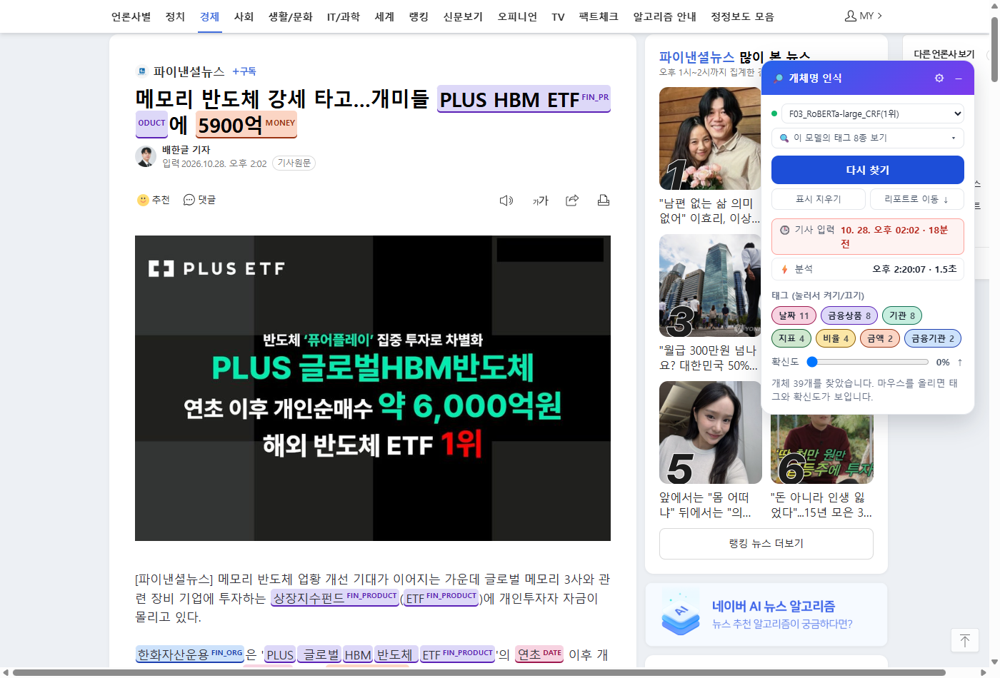
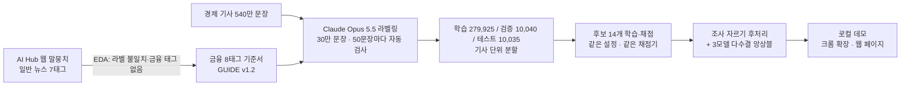
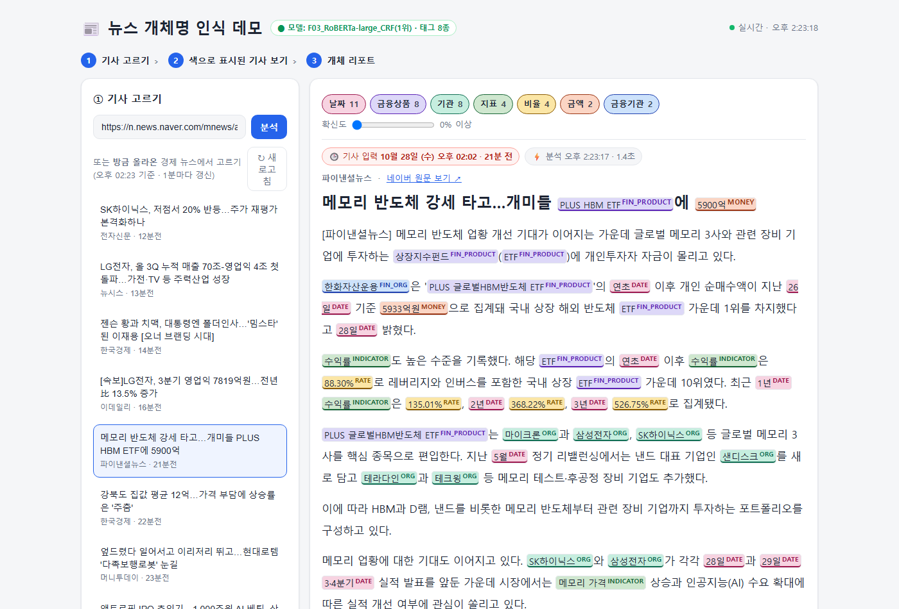
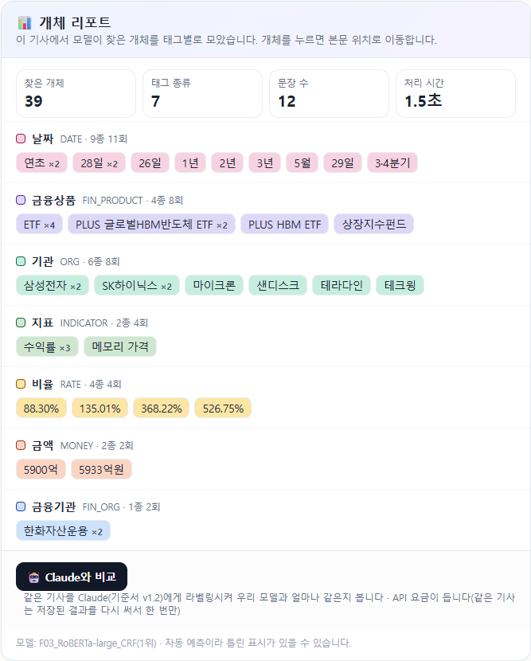

# finance-ner — 금융 기사에서 기관·금액·지표를 글자 위치까지 찾는 개체명 인식

> 한국어 금융 기사 문장에서 **금융기관·기업·금융상품·금액·비율·날짜·지표·정책** 8종을 `(시작 글자, 끝 글자, 태그)`로 찾아냅니다.
> 금융 라벨 30만 문장을 직접 만들고 후보 모델 14개를 같은 조건으로 비교해 **test F1 0.929(단일 모델) · 0.930(앙상블)** 을 얻었습니다.
> NLP 6기 실전 프로젝트 1 · 2팀(김병석 · 김현호 · 박규태 · 진태현 · 최세진) · 2026년 10월



*크롬 확장 데모. 네이버 경제 기사를 열고 버튼을 누르면 내 PC에서 돌아가는 모델이 개체를 찾아 기사 위에 칠합니다(노트북 CPU, 문장 12개 기사 1.5초).*

## 한눈에 보기

| 항목 | 내용 |
|---|---|
| 문제 | 금융 기사 속 "누가·언제·얼마·몇 %"를 정확한 글자 범위로 뽑기. `2,450억원으로`가 아니라 `2,450억원`까지만 맞아야 정답 |
| 출발점 | AI Hub 웹 말뭉치(일반 뉴스 7태그)로 1단계 모델 → test F1 0.733(30만 문장) → 0.777(120만 문장) |
| 전환점 | EDA 결과, 점수를 막은 원인은 모델이 아니라 **라벨 일관성**이었고, 금융에 필요한 금액·비율·날짜·지표 태그도 없었음 |
| 해결 | 금융 8태그와 경계 규칙을 기준서로 정하고, Claude Opus 5.5가 기준서를 따라 30만 문장을 라벨링(5명 × 6만, 자동 검사 통과분만 저장) |
| 모델 | 다섯 가지 축(경제 도메인 사전학습 · 1단계 이어받기 · 구조·크기 · CRF · 생성형 LLM)으로 후보 14개 비교 |
| 결과 | 1위 **경제 사전학습 RoBERTa-large + CRF**: test F1 0.9289 · 앙상블(03+12+03s) 0.9303 · 처음 보는 기사 350문장 0.9343 (모두 후처리 포함) |
| 데모 | 크롬 확장 + 웹 페이지 + FastAPI 서버. **모두 내 PC에서만** 돌아감 |

## 왜 만들었나

공시·뉴스 모니터링, 금융 검색·RAG의 메타데이터 붙이기는 모두 "어느 기관이 · 언제 · 얼마를 · 몇 %로"를 정확히 뽑는 데서 시작합니다. 금융에서는 숫자 한 글자만 틀려도 뜻이 바뀌므로 **글자 위치까지 정확한 개체명 인식(NER, Named Entity Recognition)** 이 필요합니다.

> **미래에셋증권**`금융기관`은 **3분기**`날짜` **영업이익**`지표`이 **2,450억원**`금액`으로 **전년**`날짜` 대비 **12.5%**`비율` 증가했다.

LLM에게 문장마다 물어볼 수도 있지만 느리고 비용이 계속 듭니다. 같은 조건에서 잰 값은 이렇습니다.

| 방식 | 처리량 | 비용 | 정확도(test_2000 F1) |
|---|---|---|---|
| Claude Opus API | 100문장 217초 | 100문장 약 $0.28 | (라벨러로 사용) |
| gpt-oss-20b + LoRA (생성형, 200억 파라미터) | 2,500문장 22.8분 | GPU | 0.918 |
| **우리 인코더 + CRF (3억 파라미터)** | **1만 문장 약 11초** | GPU 1장 | **0.924** |

## 어떻게 동작하나



1. **EDA로 방향 바꾸기** — 원본 라벨에서 자주 나오는 개체의 17.3%가 문장마다 다른 태그였고, 33.5%는 라벨이 빠져 있었습니다(예: 같은 '검찰은 ~했다' 구조인데 라벨 3번, 빠짐 48번). 경제 문장에는 지표·비율·날짜·금액이 각각 15% 넘게 나오는데 원본에는 이 태그가 없었습니다. → 원본 라벨을 고쳐 쓰지 않고 **새 기준서로 일관된 라벨을 만들기로** 했습니다.
2. **라벨링** — 팀이 직접 라벨링한 40문장으로 기준서를 만들고, 정답이 있는 10문장 시험(F1 0.9 이상)을 통과한 뒤 시작했습니다. 50문장마다 도구가 원문에 없는 글자·겹침·태그 오타·빠진 문장을 검사해 통과해야 저장했고, 판단이 갈린 15개 항목을 정해 v1 → v1.2로 고친 뒤 30만 문장 전체에 다시 적용했습니다(8,058문장 수정).
3. **라벨 품질 확인** — 학습에 쓰지 않은 새 기사 350문장에 상위 모델 Fable 5.1이 같은 기준서로 따로 라벨을 달게 했더니 Opus 라벨과 **F1 0.975**(문장 완전 일치 325/350)로 일치했습니다. 이 350문장은 외부 테스트로도 씁니다.
4. **학습과 채점** — 글자 위치 정답을 각 토크나이저의 토큰에 BIO 꼬리표로 옮겨 학습하고, 예측을 다시 글자 위치로 되돌려 **시작·끝·태그가 모두 같아야 정답**인 하나의 채점기([`src/stage2/fin_score.py`](src/stage2/fin_score.py))로 채점합니다. 설정은 검증 세트로만 정하고 test는 마지막에 한 번만 봤습니다.
5. **후처리와 앙상블** — 토크나이저가 `대출금리에`를 `[대출금] [##리에]`로 잘라 조사까지 잡히는 경우를 형태소 분석기 Kiwi로 찾아 조사 앞에서 자릅니다. 규칙 4개를 검증 세트로만 시험해 이 하나만 남겼습니다(dev +0.0029). 앙상블은 서로 다른 모델 3개 중 2개 이상이 같은 위치·태그로 단 개체만 남깁니다.

## 금융 라벨 8종

| 태그 | 뜻 | 예 |
|---|---|---|
| `FIN_ORG` | 금융회사, 금융 감독·정책 기관 | 우리은행, 한국투자증권, 금융위원회, 한은 |
| `ORG` | 그 밖의 기업·기관 | 삼성전자, 국토교통부 |
| `FIN_PRODUCT` | 금융상품 유형·상품명 | ETF, 회사채, 주택담보대출 |
| `MONEY` | 금액 | 5000억원, 1조원 |
| `RATE` | 비율·금리 값 | 3.5%, 0.25%p |
| `DATE` | 날짜·기간 | 2026년 10월, 3분기, 지난해 |
| `INDICATOR` | 경제·금융·재무 지표 | 코스피, 기준금리, 영업이익 |
| `POLICY` | 금융·부동산 정책·규제·세제 | DSR, LTV, 종합부동산세 |

경계 규칙 예: 조사 빼기(`우리은행은` → `우리은행`), 지표와 값 따로(`기준금리` / `3.5%`), 수식어·'지난'·시각 빼기(`약 5000억원` → `5000억원`, `지난 9일` → `9일`). 전체 규칙은 [`fin_label_kit/GUIDE.md`](fin_label_kit/GUIDE.md)에 있습니다.

## 결과

### 후보 모델 비교 (금융 8태그)

모든 모델은 3에폭 · 배치 16 · 최대 256토큰 · 예열 10% · 시드 42로 같은 조건에서 학습했습니다. 점수는 개체 단위 엄격 일치 micro F1이고, **0.007 미만 차이는 "차이 없음"** 으로 보기로 결과를 보기 전에 정했습니다(같은 크기의 다른 데이터로 학습했을 때 흔들림 표준편차 0.0037의 2배).

| RUN | 모델 | test F1 | test F1 (후처리) | 외부 350 (후처리) |
|---|---|---|---|---|
| **03** | **경제 사전학습 RoBERTa-large + CRF** | **0.9258** | **0.9289** | 0.9245 |
| 07 | 03 + 1단계 NER 500만 문장 이어받기 | 0.9233 | 0.9265 | 0.9252 |
| 10 | klue/bert-base + CRF | 0.9220 | 0.9253 | 0.9150 |
| 11 | klue/roberta-base + CRF | 0.9221 | 0.9253 | 0.9160 |
| 02 | 경제 사전학습 RoBERTa-base + CRF | 0.9214 | 0.9245 | 0.9227 |
| 03c | 03을 5에폭까지 이어 학습 | 0.9212 | 0.9243 | 0.9250 |
| 12 | KoELECTRA-base-v3 + CRF | 0.9206 | 0.9237 | **0.9314** |
| 03s | 경제 사전학습 RoBERTa-large + softmax | 0.9201 | 0.9233 | 0.9194 |
| 01 | 1단계 NER 120만 문장 이어받기 RoBERTa-base + CRF | 0.9184 | 0.9216 | 0.9088 |
| 06 | 02 + 1단계 NER 500만 문장 이어받기 | 0.9174 | 0.9204 | 0.9097 |
| 04 | 경제 사전학습 mmBERT(1에폭) + CRF, 형태소 입력 | 0.9091 | 0.9091 | 0.8957 |
| 05 | 경제 사전학습 mmBERT(2에폭) + CRF, 형태소 입력 | 0.9088 | 0.9088 | 0.8998 |
| 08 | 04 + 1단계 NER 500만 문장 이어받기 | 0.9045 | 0.9045 | 0.8936 |
| 09 | gpt-oss-20b + LoRA 생성형 | (test_2000만 0.9182) | — | — |
| 13 | mmBERT-small (다른 분할로 학습, test 비교 제외) | (0.8702) | (0.8796) | 0.8707 |
| **앙상블** | **03 + 12 + 03s 다수결** (dev로 조합 선택) | 0.9272 | **0.9303** | **0.9343** |

- test = 10,035문장(정답 개체 22,556개). 외부 350 = 학습에 없던 네이버 경제 기사 350문장(8분야 · 2020~2026년 · 34개 언론사, Fable 5.1 라벨).
- 형태소 입력 모델(04·05·08)은 조사가 이미 떨어져 들어가므로 후처리 점수가 같습니다.
- 원본 점수: [`results/stage2/`](results/stage2/) (RUN별 JSON, 후처리 종합 `후처리점수_종합.json`).

### 무엇이 도움이 됐고, 무엇이 아니었나

| 비교 (test F1) | 차이 | 결론 |
|---|---|---|
| CRF vs softmax (03 vs 03s) | +0.0057 | dev·test·test_2000 모두 CRF 쪽 → **채택** |
| large vs base (03 vs 02) | +0.0044 | 일관되게 large 쪽. 1단계에선 효과 없었는데 라벨이 깨끗해지자 드러남 |
| 경제 도메인 사전학습 (02 vs 11) | −0.0007 | **큰 효과 없음** (2에폭 더 해도 05 ≈ 04) |
| 1단계 NER 이어받기 (06−02 / 07−03 / 08−04) | −0.0040 / −0.0025 / −0.0046 | **세 번 모두 손해 방향**. 7태그 습관이 8태그에 방해 |
| 에폭 늘리기 (03c 5에폭 vs 03) | −0.0046 | dev 0.9251 → 0.9222. 3에폭 유지 |
| 생성형 LLM (09 vs 03, test_2000) | −0.0058 | 더 낮고 훨씬 느림 |
| 서로 다른 3모델 앙상블 (vs 03) | +0.0014 (외부 +0.0099) | 작지만 dev·test·외부 모두 같은 방향 |

**정리: 가장 큰 차이를 만든 것은 모델이 아니라 데이터를 분석하고 라벨을 일관되게 다시 만든 것**이었습니다(일반 뉴스 7태그 0.78 → 금융 8태그 0.929).

### 오답에서 본 것

- 모든 모델이 같은 순서로 틀렸습니다: 없는 개체를 잡음 > 놓침 > 경계 > 태그. 인코더 13개가 **모두** 틀린 test 정답이 840개(3.7%)입니다.
- 가장 약한 태그는 데이터에서 가장 드문 금융상품(6.1%)·정책(2.1%)입니다(RUN 03 test 0.799 · 0.788).
- 많이 틀린 말은 주식·펀드·금리·이날·매출처럼 라벨러마다 다르게 단 일반 단어였습니다 → 기준서 다음 개정 과제.

### 1단계 (일반 뉴스 7태그)

| 학습 문장 수 | 결과 |
|---|---|
| 1,500 → 60만 | 늘릴 때마다 흔들림 기준보다 크게 오름(6만 → 20만 dev +2.8점) |
| 30만 → 120만 | test F1 0.733 → 0.777 (고친 정답 기준) |

데이터 양과 CRF(+1.3점)는 효과가 있었고, roberta-large·학습률 조정·5에폭·KoELECTRA·가중 손실·드문 태그 보강은 효과가 없었습니다. 자세한 기록: [`docs/결정기록.md`](docs/결정기록.md), 그림: [`docs/img/`](docs/img/).

## 데모 (내 PC에서 실행)

| 화면 | 설명 |
|---|---|
|  | **웹 페이지** (`http://localhost:8000/`): 방금 올라온 네이버 경제 기사를 고르거나 주소를 넣으면 제목·본문에 태그 색을 칠하고 태그별 리포트를 보여 줍니다. |
|  | **개체 리포트**: 태그별로 같은 개체를 모아 횟수를 셉니다. 확신도 슬라이더로 낮은 확신 개체를 숨길 수 있습니다. |

- 모델 고르기: 패널의 선택 상자에서 `demo/models/`에 있는 모델과 **앙상블(03+12+03s)** 중 하나를 고릅니다.
- **Claude와 비교(선택)**: 환경 변수 `ANTHROPIC_API_KEY`가 있을 때만 켜집니다. 같은 기사를 Claude(기준서 v1.2)가 라벨링한 결과와 일치도(F1)·다르게 단 개체 목록을 보여 주며, 한 번 받은 결과는 `demo/server/claude_cache/`에 저장해 다시 요금이 들지 않습니다.
- 서버는 `localhost`에서만 열리고 외부 서버를 쓰지 않습니다. 키는 서버에만 있고 확장으로 가지 않습니다.

## 설치와 실행 (Windows · Python 3.11)

```powershell
# 1) 받기
git clone https://github.com/ner-finance-team/finance-ner.git
cd finance-ner\demo

# 2) 가상환경과 패키지 (CPU PC는 torch CPU판을 먼저 깔면 용량이 작습니다)
python -m venv .venv
.\.venv\Scripts\python -m pip install torch==2.14.1 --index-url https://download.pytorch.org/whl/cpu
.\.venv\Scripts\python -m pip install -r requirements.txt

# 3) 모델 폴더를 demo\models\ 아래에 둔다 (가중치는 저장소에 없음 → demo\models\README.md)

# 4) 서버 켜기 → http://localhost:8000/
.\run_server.bat
```

**크롬 확장 올리기**: 크롬 주소창에 `chrome://extensions` → 오른쪽 위 **개발자 모드** 켜기 → **압축해제된 확장 프로그램을 로드합니다** → `demo\extension` 폴더 선택 → 네이버 뉴스 기사를 열면 오른쪽에 패널이 뜹니다. 코드를 바꾼 뒤에는 확장 카드의 새로고침(↻) 버튼을 누릅니다.

| 막히는 곳 | 해결 |
|---|---|
| `모델 폴더가 없습니다` | `demo\models\<모델 이름>\` 안에 `config.json`과 `model.safetensors`가 함께 있어야 목록에 나옵니다 |
| 패널에 "서버 연결 안 됨" | `run_server.bat` 창이 켜져 있는지, ⚙ 버튼의 주소가 `http://localhost:8000`인지 확인 |
| 앙상블이 목록에 없음 | 이름이 `F03_` · `F12_` · `F03s_`로 시작하는 모델 폴더 3개가 모두 있어야 합니다 |
| 노트북이 느림 | 1위 모델(RoBERTa-large)은 CPU에서 기사 한 건 1~9초. 더 빠르게는 12 KoELECTRA(파라미터 약 1/3) |

## 폴더 지도

```
finance-ner/
├─ README.md
├─ demo/                      로컬 데모
│  ├─ server/                 FastAPI 서버: app.py(API) · ner_engine.py(모델 추론 + 조사 자르기) · claude_engine.py(선택: Claude 비교)
│  ├─ extension/              크롬 확장 (manifest v3, 네이버 기사 위에 표시)
│  ├─ web/index.html          웹 페이지
│  ├─ models/                 모델 폴더를 두는 곳 (가중치는 git 제외)
│  ├─ requirements.txt · run_server.bat
├─ src/                       데이터 구축 · 1단계 학습 · 채점
│  ├─ ner_lib.py              공통: 글자 span ↔ 토큰 BIO 변환, 형태소 분리, 디코딩
│  ├─ prepare_data.py · build_all_spans.py · make_splits.py …   원본 → 글자 위치 정답 → 분할
│  ├─ train_big.py · run_experiments.py · evaluate.py …         1단계 학습·평가
│  ├─ extract_econ.py · make_fin_1m.py · split_fin_v12.py …     경제 문장 추출 · 금융 데이터 분할
│  ├─ dapt_mlm.py · dapt_colab.py · make_dapt_corpus.py         경제 도메인 사전학습(MLM)
│  ├─ stage2/                 금융 8태그 학습(fin_ft.py, 이어 학습 fin_ft_cont.py) · 공통 채점기(fin_score.py) · 생성형(ft_gptoss_ner.py)
│  └─ postproc/               후처리 규칙 시험(pp_rules.py) · 적용(pp_all.py) · 채점 종합(pp_sum.py) · 앙상블(ens.py)
├─ fin_label_kit/             라벨링 키트: 기준서(GUIDE.md) · 정답 예시 · 검사 도구(label_tool.py) · Claude 스킬
├─ notebooks/                 Colab 실험 노트북 (D: 데이터 양·사전학습, E: 기준선·생성형, M: 1단계 모델 비교, F: 금융 학습, J·R: 라벨 오류·결과 분석, T: 팀원 실험용)
├─ results/                   점수 JSON (stage1: 1단계, stage2: 금융 RUN 01~13 + 후처리 종합)
├─ docs/                      연구계획서 · 결정기록 · 데이터 분석 · 결과 종합 · 발표 자료(PDF) · 그림
└─ 회의록/
```

## 한계와 다음 단계

- **정답도 LLM 라벨**: 사람이 전부 검수하지 않았습니다. 상위 모델과의 일치도(0.975)와 외부 기사 테스트로 보완했습니다.
- **라벨이 흔들리는 곳**: 일반 단어(주식·펀드·금리), 금융기관/기관 구분, '오는'·'시장' 범위 → 기준서 v1.3.
- **후처리 넓히기**: 조사가 아닌 꼬리말('장'·'째' 등)은 아직 시험하지 않았습니다.
- **확장**: 학습량 곡선상 데이터를 늘릴 여지가 있고, 공시·보도자료 같은 실제 금융 문서로 넓힐 수 있습니다.
- 공개하지 않은 것: AI Hub 원본 데이터와 라벨 데이터(이용 약관), 모델 가중치(용량), 예측 파일(용량).

## 사용한 기술

| 분류 | 도구 |
|---|---|
| 모델 | klue/roberta-large · klue/roberta-base · klue/bert-base · KoELECTRA-base-v3 · mmBERT · gpt-oss-20b(LoRA) |
| 학습 | PyTorch, Hugging Face Transformers, pytorch-crf, bf16 혼합 정밀도, Colab · 학교 GPU 서버 |
| 한국어 처리 | Kiwi(kiwipiepy) 형태소 분석 |
| 라벨링 | Claude Opus 5.5(라벨러) · Claude Fable 5.1(품질 확인), 자체 검사 도구 |
| 데모 | FastAPI · Uvicorn · BeautifulSoup · Chrome Extension(Manifest V3) |

## 함께 보면 좋은 문서

- [발표 자료 (PDF)](docs/발표_금융NER.pdf) — 27장, EDA부터 결과까지
- [연구계획서](docs/연구계획서.md) — 프로젝트 초기 계획(이전 README)
- [결정기록](docs/결정기록.md) — 날짜별 실험·결정과 근거
- [금융 NER 결과 종합](docs/금융NER_결과종합_1027.md) · [데이터 분석 리포트](docs/01_데이터_분석_리포트.md)
- [라벨링 기준서 v1.2](fin_label_kit/GUIDE.md) · [통합본 정리 기록](docs/라벨_통합본_v1.2_정리기록.md)
